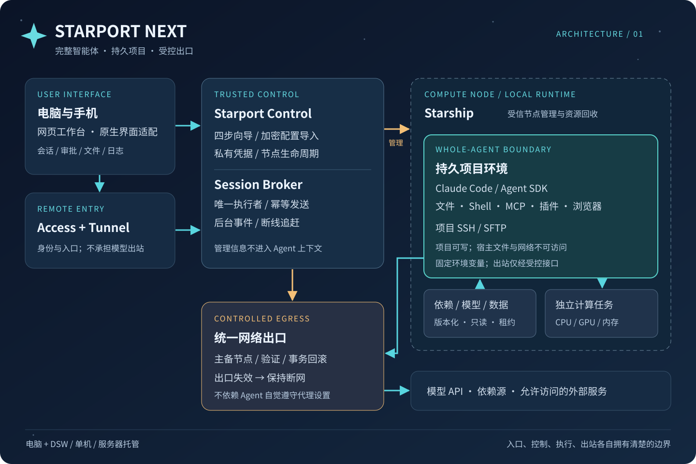

# ✦ Starport Next

**智能体项目工作区、受控网络与统一管理面板。**

控制端面向 Windows、macOS、Linux；项目程序在受控环境中运行。Starport 管理网络、工作区、算力接口和文件，Claude Code／Agent SDK 提供智能体能力。已实现功能、平台验收与后续接入范围见下文。



| 配置蓝图 | 用户填写 | 目标行为 |
| --- | --- | --- |
| 1. 网络出口 | 订阅、主节点和备用节点 | 验证、应用、健康检查、失败回滚 |
| 2. 执行节点 | SSH 或 DSW 连接、资源预算 | 核对实例与指纹，初始化隔离环境 |
| 3. 项目与依赖 | 项目、依赖版本、模型 | 持久工作区、只读依赖和独立新增依赖层 |
| 4. 远程访问 | Cloudflare Token、域名、邮箱 | Tunnel、Access、权限与重连验证 |

**当前交付：配置工具、本地隔离工作区与控制面板。** 已实现加密导入／导出、Pi v1 配置迁移、QEMU 工作区、专用出口、文件操作与官方 Agent SDK 接入。新增 Windows 原生控制端、WSL2 项目接入层、文件面板和既有训练 API 适配；验证边界见[验收记录](docs/ACCEPTANCE.md)。账号 CLI／Desktop 的 guest 安装和画面入口见[官方账号客户端](docs/NATIVE-CLIENTS.md)。API 网页会话见[会话管理](docs/SESSIONS.md)；逐工具审批、附件和远端 DSW 自动部署仍按[实施路线](docs/ROADMAP.md)推进。

订阅附送的 API 额度适用于自建工作台的 Agent SDK 会话；原生 Desktop 的 Code 会话另按其适用方式计费。[入口与额度](docs/DESIGN.md#入口与额度)

Windows 优先采用 **主系统管理网络与服务器，WSL2 执行项目程序**。主系统可以读写项目文件，工作区不挂载 Windows 文件。已提供 Claude Code、Agent SDK、Linux Desktop 与浏览器安装入口；独立 WSLg 窗口需显式开启，并与 Windows 共享显示和剪贴板。安装与访问码窗口见 [Windows 控制端](docs/WINDOWS-HOST.md)，兼容性和待验证项见 [WSL2 评估](docs/WSL2-ASSESSMENT.md)。

面板采用左侧导航，支持[多服务器](docs/MULTI-SERVER.md)分别监控、筛选任务和暂停接单。
[远程访问页](docs/REMOTE-ACCESS.md)可设置已有 Cloudflare Access 的域名、邮箱和 Tunnel。
同一入口可打开 WSL2 项目桌面操作 Claude Code CLI／Desktop，或在「会话」中直接对话、查看工具结果、续接历史和停止 Agent SDK；账号认证各自独立。
启用 WSLg 的 Windows 安装会创建浏览器、Claude Desktop 和 Claude Code 的桌面／开始菜单
快捷方式，通过控制端进入项目；不要直接使用发行版的 `wslg.exe` 自动图标启动应用。
快捷方式默认保留客户端原图标与名称；安装 skill 包含 WSLg／网页桌面的逐项回归清单。
[依赖与数据](docs/DEPENDENCIES.md)页可发布环境、数据目录的固定只读版本，供 Claude 任务选择。
服务器任务面板提供资源概况、筛选、日志、产物下载和取消；服务页可注册 Windows
登录启动。Claude Code／Desktop 通过项目计算 MCP 接入远端任务，项目内自动生成
`AGENTS.md` 和 `CLAUDE.md`。配置页可加密导出、预览并导入到新配置；不自动切换当前安装。
官方账号登录及 Desktop 真实对话验收仍独立记录。

## 先试配置

需要 Node.js 22 或更高版本。

```sh
npm ci --ignore-scripts
npm test
node bin/starport.mjs validate --config examples/desktop-dsw.json
node bin/starport.mjs plan --config examples/desktop-dsw.json
```

Windows：`powershell -ExecutionPolicy Bypass -File scripts/setup.ps1`。
Linux／macOS：`sh scripts/setup.sh`。这两个入口初始化本地配置并显示计划，尚不是完整运行环境安装器。

## 从 Pi 导入

```sh
node bin/starport.mjs config preview --file backup.spx
node bin/starport.mjs config import --file backup.spx --out profiles/imported
node bin/starport.mjs plan --profile profiles/imported
```

先创建 `profiles` 父目录。口令隐藏输入；完整配置包在磁盘上仍保持加密。导入不会复制旧主机信任、Tunnel 连接令牌、进程或“已验证”状态。[配置包说明](docs/CONFIGURATION.md)

## 本机运行

```sh
node bin/starport.mjs local doctor
node bin/starport.mjs local prepare --state private/local-workspace
node bin/starport.mjs local start --state private/local-workspace --profile profiles/imported --model 选择的模型ID
node bin/starport.mjs local verify --state private/local-workspace
node bin/starport.mjs local bootstrap --state private/local-workspace
node bin/starport.mjs local chat --state private/local-workspace --prompt-file prompt.txt
```

上面是 QEMU 路线，Windows 使用它时不需要 WSL2；三个控制端共用独立 Linux guest 的执行与网络边界。默认 2 核／2 GiB／8 GiB 虚拟磁盘，完整 Agent 在其中运行。[安装、文件传输和停止命令](docs/LOCAL-RUNTIME.md)。Windows 主系统＋WSL2 路线使用[独立安装入口](docs/WINDOWS-HOST.md#安装)。

## 设计与实现

| 文件 | 内容 |
| --- | --- |
| [总体设计](docs/DESIGN.md) | 拓扑、四步向导、网络与服务器生命周期、SSH 边界 |
| [安全边界](SECURITY.md) | 整个 Agent 隔离、凭据、网络和依赖可见范围 |
| [复用计划](docs/REUSE.md) | 从既有网络、会话与算力实现提取什么 |
| [验收矩阵](docs/ACCEPTANCE.md) | 哪些已测，哪些必须在目标机器验收 |
| [独立计算资源](docs/COMPUTE.md) | SSH／DSW worker、CPU／GPU 任务与 Claude 调用 |
| [后台服务](docs/SERVICES.md) | Windows 登录启动、进程恢复与服务管理 |
| [多服务器](docs/MULTI-SERVER.md) | 节点登记、默认服务器与任务归属 |
| [远程访问](docs/REMOTE-ACCESS.md) | 域名、邮箱、Access 与 Tunnel 设置 |
| [Agent 入口](AGENTS.md) | 安装、开发和接手指引 |

```text
bin/                    配置工具入口
packages/config/        配置模型、加密包、Pi 迁移与私有存储
packages/planner/       离线配置规划
packages/runtime/       本地虚拟机、出口、文件与 Agent SDK
packages/control/       宿主面板、Access、计算适配与进程管道
packages/wsl/           专用 WSL2 安装与项目运行边界
packages/contracts/     状态判定与组件接口
packages/adapters/      后续运行时适配规范
examples/               三种可移植部署预设
skills/                 Agent 安装与卸载流程
docs/                   架构、图示、验收和实施路线
scripts/                配置初始化与仓库检查
tests/                  导入、权限边界和状态回归测试
```

```sh
npm test
npm run check
```
