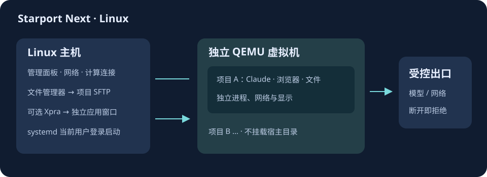
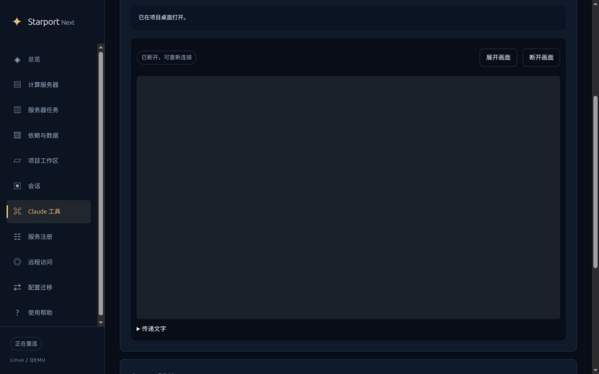

# Linux 控制端

Linux 主机运行管理面板，独立 QEMU 虚拟机运行项目。项目之间再分开文件、进程、网络与显示；项目程序不能访问宿主 HOME 或宿主管理凭据。



| 入口 | 用途 |
| --- | --- |
| 项目工作区 | 文件上传、下载、编辑、终端与边界验证 |
| 会话 | Agent SDK 对话、工具结果、历史与取消 |
| Claude 工具 → 网页项目桌面 | 浏览器、Claude Code、Claude Desktop；也可经 Access 访问 |
| Claude 工具 → Xpra 无缝窗口 | 应用显示为 Linux 桌面的独立窗口；需本机登录和显式启用 |
| 打开项目文件夹 | SSHFS 只连接当前项目；可在本机文件管理器读写 |
| 服务注册 | systemd 当前用户登录启动，分别管理虚拟机、控制端和计算连接 |

## 安装

Ubuntu 24.04 是当前验证目标。需要 KVM 权限、Node.js 22+，完整客户端建议至少 4 GiB 虚拟机内存及 16 GiB 虚拟磁盘。安装器不替换系统 PATH。若 `local doctor` 提示无法访问 `/dev/kvm`，先执行 `sudo usermod -aG kvm "$USER"`，注销并重新登录后再安装工作区；不要将设备改成所有用户可写。

```sh
sh scripts/setup-control.sh --install-prerequisites
```

在私有配置中填写已经选好的订阅节点；结构与 Windows 相同，详见 [Windows 配置示例](WINDOWS-HOST.md)。配置和凭据均通过相对路径引用。例如：

```json
{
  "format": "starport-host-control",
  "version": 1,
  "port": 18884,
  "runtime": {"kind": "qemu", "state": "qemu"},
  "nodesFile": "nodes.json",
  "seamless": false
}
```

`nodesFile` 指向已解析的订阅节点文件。API 会话另外设置 `apiKeyFile` 与 `model`；官方账号客户端在项目内自行登录。空配置的出口保持关闭。

```sh
node bin/starport.mjs linux install --config private/host-control.json
sh scripts/start-control.sh
```

打开终端显示的本机地址。访问码可用下面的本机窗口读取：

```sh
node scripts/linux-open.mjs --state private/control --app access
```

进入面板后点击“验证边界”，通过后即可使用文件、终端和客户端。边界测试会短暂暂停本安装出口，因此有活动项目时拒绝执行；不改动其他安装或服务器。



## 可选无缝窗口

```sh
sudo apt-get install --no-install-recommends xpra xvfb xauth python3-pil
```

在首次 `linux install` 前设置 `"seamless": true`，以便同时安装虚拟机内的 Xpra 服务。已安装的虚拟机也可在设为 `true` 后重新执行 `linux install` 补装，须先关闭本安装项目应用。需要本机 X11 或 XWayland 和有效的显示授权；无 XWayland 的纯 Wayland 会话暂不支持。

工作区内使用独立 Xpra/Xvfb；宿主只运行受限的画面客户端。传输经过现有加密控制通道，不开放 Xpra 公网端口。自动剪贴板、文件传输、打印、音频、摄像头、宿主 URL 打开均关闭。文件使用面板或项目文件夹入口。

选择“本机 Xpra 无缝窗口”后启动应用。切换到网页桌面前先关闭该项目的图形应用，避免两个显示入口争用同一客户端。无缝显示需要实际桌面环境验收；安装成功不代表官方账号登录已经完成。

```sh
node bin/starport.mjs linux shortcuts register --state private/control --seamless
```

应用菜单新增面板、访问码、浏览器、Claude Desktop 和 Claude Code。未启用无缝窗口时去掉 `--seamless`，仅注册面板与访问码入口。可用 `--workspace 项目ID` 注册其他项目。

## 文件与更新

“打开项目文件夹”使用专用 SFTP 账号，其文件根目录限制在该项目，禁止 shell、端口和 Agent 转发。SSHFS 挂载位于控制状态目录的 `project-folders/项目ID`。项目不能反向访问宿主文件；文件内容本身仍由项目程序控制。

升级代码后，先关闭本安装的本机项目命令和图形应用，再更新运行时：

```sh
node bin/starport.mjs linux update-runtime --config private/host-control.json
```

更新会获取运行时独占锁；有活动项目时拒绝覆盖。虚拟机身份或运行时代码改变会使旧验证失效，需要再次点击“验证边界”。旧的 `local-*` 单工作区虚拟机保留原入口，新面板使用独立状态目录，不自动迁移。

## 登录启动与移除

见 [服务管理](SERVICES.md#linux-当前用户服务)。启用只安排下次用户登录，不打断当前手动运行的控制端。不会设置系统级服务或自动开启 linger。

卸载前先导出项目，停用本安装服务并退出应用。文件夹仍挂载时先用 `fusermount3 -u` 卸载该项目挂载点；不要在挂载点内递归删除。菜单入口可安全移除：

```sh
node bin/starport.mjs linux shortcuts remove --state private/control
```

操作仅处理收据中内容未改变的本安装文件。虚拟磁盘和项目数据默认保留；永久删除须单独选择。

Ubuntu 24.04 的最小镜像需要为 namespace 启动器明确授予 `userns` 权限。安装器仅在这台受管虚拟机内配置 `/usr/bin/bwrap` 的专用 AppArmor 规则，保留系统的全局限制、项目 seccomp 和 Chromium 自身沙箱。原理见 [Ubuntu 官方说明](https://documentation.ubuntu.com/security/security-features/privilege-restriction/apparmor/)。Xpra 适配当前验证 3.1 系列，其他版本明确拒绝连接，避免未经验证地传送显示信息。
