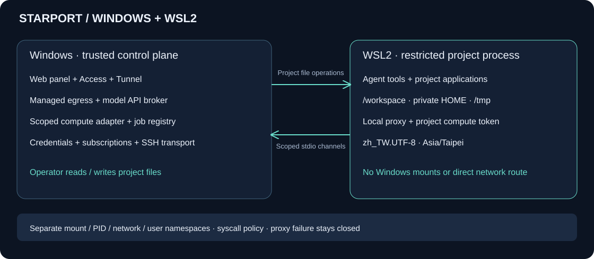

# Windows 控制端与 WSL2 工作区

Windows 主系统运行 Starport，管理网络出口、服务器连接、文件面板与远程访问。WSL2 内的项目程序通过受限进程管道使用这些能力。Windows 可以管理项目文件，项目程序不能挂载或浏览 Windows 文件系统。



## 当前实现

| Windows 控制端 | WSL2 项目环境 |
| --- | --- |
| Node.js 管理服务与网页面板 | Python／Shell、Claude Code、Agent SDK 与项目文件 |
| 独立 Mihomo 出口及主备节点 | 仅有本地代理入口，没有外网路由 |
| 模型 API Key、计算服务凭据 | 可撤销的模型与项目计算令牌 |
| Access JWT 验证、cloudflared 进程 | 不接触 Access 邮箱、Tunnel Token |
| 上传、下载、改名、文件夹和删除 | `/workspace`、独立 HOME 与 `/tmp` |
| 计算服务状态与任务登记 | 提交、状态、日志、取消、产物下载 |
| WSLg 启用开关与客户端入口 | Linux Desktop、浏览器、CLI 独立窗口 |

这版包含控制平面、项目执行边界、SDK 单任务入口和 WSLg 客户端启动器。SDK 任务可执行文件和 Shell 工具，仍不是带重连、幂等发送和审批卡片的完整会话网页。官方账号授权与工具调用必须在用户登录后另行验收。

## 安装

在 Windows PowerShell 中进入仓库：

```powershell
powershell -ExecutionPolicy Bypass -File scripts/setup-control.ps1 -InstallPrerequisites
powershell -ExecutionPolicy Bypass -File scripts/setup-wsl.ps1
powershell -ExecutionPolicy Bypass -File scripts/start-control.ps1
```

没有 WSL2 时，第二步加 `-InstallWsl`。系统功能安装会调用 Windows 授权窗口；需要重启时由用户决定。安装器不安装 QEMU，不替换系统 PATH，不改变默认发行版，也不执行 `wsl --shutdown`。

Ubuntu 镜像来自官方 WSL 下载目录，按同目录 SHA-256 核验后导入一个新名称 `StarportWork-…`。也可以使用 `-Rootfs` 与 `-Sha256` 指定已下载镜像。安装完成后只重新启动这个新发行版。它会安装安全更新后的基础依赖、bubblewrap、libseccomp、Python、Git、curl、locale 和 Noto CJK 字体。

默认面板：`http://127.0.0.1:18884/`。本机访问码在 `private/control/panel-key.json`，通过面板登录。初始出口关闭；先导入并选择受控节点，再点击“验证边界”。验证通过后才允许在面板终端执行命令。控制进程退出后必须重新验收。

按 setup skill 完成安装后，应弹出本机访问码窗口，提供“显示访问码”“复制访问码”和“打开面板”。窗口只读取当前部署的状态目录，用户点击后才写入剪贴板。也可在另一个 PowerShell 窗口手动打开：

```powershell
powershell -NoProfile -STA -ExecutionPolicy Bypass -File scripts/show-access-code.ps1 -State private/control
```

使用自定义状态目录时，将 `-State` 改为该部署的实际控制端目录。此窗口不代表 Claude Code、Agent SDK、Desktop 或浏览器已经安装或登录。

当前启动方式为前台进程，关闭网页不会停止服务。没有自动注册开机或登录启动项。

## 复用导入配置

已有 Starport 或 Pi 配置包可以先按[配置导入](CONFIGURATION.md)导入，再启动：

```powershell
node bin/starport.mjs config import --file backup.spx --out profiles/imported
powershell -ExecutionPolicy Bypass -File scripts/start-control.ps1 -Profile profiles/imported -Client native
```

`native` 模式关闭 API Key 网关；工作区官方账号客户端使用独立登录。`-Client api` 启用 SDK 网关，真实 Key 留在 Windows；WSLg 账号客户端仍不接收 SDK 的模型令牌，并使用独立的 `.claude-account` 配置目录。配置包的口令只在本机终端隐藏输入。

受控出口复用配置包中已选择的主备节点。Windows 需要可用的 Mihomo 可执行文件；也可以在控制端配置中通过相对路径指定 `proxyBinary`。实际节点及订阅缓存保留在私有配置中。

## 安装 Claude 客户端与 WSLg

先安装专用发行版、配置好控制端的 `nodesFile` 和 `proxyBinary`，并结束该部署的项目操作。然后运行：

```powershell
powershell -ExecutionPolicy Bypass -File scripts/setup-wsl-clients.ps1 -State private/wsl -Config private/host-control.json -EnableWslg
```

`-EnableWslg` 是明确选择与 Windows **共享显示和剪贴板**。省略时只安装客户端，不开启图形入口。不要把其他用户的共享偏好写成默认批准；如果当前对话已作选择，无需再次询问。

安装器通过所选节点启动临时、独立出口，下载官方签名的 Claude Code／Linux Desktop、Chrome（x64）或 Firefox（arm64）、校验摘要的 Node 和锁定版本的 Agent SDK。管理下载中继只监听当前 WSL NAT 的宿主接口，并限定该发行版的来源地址；项目命名空间没有访问该接口的路由。镜像网络或无法确认接口所有权时明确失败，不切换直连。软件安装日志及收据留在私有 `wsl/client-install` 中。

重启本项目的控制进程，点击“验证边界”，再使用“Claude 工具”区的入口：

- **检查安装与登录**：分别报告 CLI、SDK、Desktop、浏览器；不返回账号邮箱或组织。
- **浏览器／Claude Desktop／Claude Code**：应用在同一项目的持久图形会话中运行，使用 `/workspace` 和私有 HOME。关闭面板不会关闭这些窗口；“关闭工作区应用”或控制进程退出会结束该图形会话。
- **Claude Code 登录**：在 WSLg 终端执行官方登录。浏览器 opener 指向工作区内的浏览器，不调用 Windows 浏览器。Desktop 单独使用自己的账号登录。

首次启动可能出现 **Choose password for new keyring**，之后可能要求解锁。用户在窗口内设置／输入密码，不在聊天中提供；不要通过空密码或 `--password-store=basic` 绕过。登录令牌保存在项目 HOME 中，同一项目的程序可能读取该身份下的资料。

图形入口只传入 Wayland 和 X11 的指定 socket，不挂整个 `/mnt/wslg`、Windows 盘、宿主 D-Bus、PulseAudio 或 GPU 设备。Chrome/Electron 保留自身沙箱；为其允许嵌套用户命名空间，但仍禁止 `setns`、挂载、vsock 和直接外网路由。普通终端命令与 SDK 不获得显示 socket，也不开放嵌套用户命名空间。

共享显示／剪贴板可能暴露其中的姓名、公司、地址、文档内容及窗口信息。语言、时区和代理设置不能保证匿名，也不能保证无法推断所在地。需要更严格的图形边界时使用独立 QEMU 画面方案。Linux Desktop 的 Cowork 另需 QEMU/KVM，本安装不提供这些能力。

## Agent SDK 的 API 配置

在私有控制配置中增加：

```json
{
  "apiKeyFile": "secrets/anthropic-api-key.txt",
  "model": "YOUR_MODEL_ID",
  "wslg": true
}
```

这些是增补字段。密钥文件只保留在 Windows 私有目录，启动时指定 `start-control.ps1 -Client api`。SDK 获得可撤销的本机网关令牌；官方账号客户端使用自己的登录，不借用 SDK 的 API 配置。模型由控制侧固定。

完成边界验证后可在“Agent SDK”区运行一个小型文件读写任务。当前入口最多 8 轮、300 秒，不设置 `maxBudgetUsd` 美元预算上限，按实际模型调用计费。控制端网关另有限次请求保护；轮数、时间、请求数与费用上限是不同约束。原始事件保存在项目 `.starport-events/` 中，显示文本单独转换，文件路径与代码字节不改写。刷新网页后不要重复提交结果未知的任务，先检查事件与产物。

## 升级已有发行版

升级前结束项目命令和图形会话；不要中断正在工作的会话。依赖升级使用上面的客户端安装器，只有运行时代码更新时执行：

```powershell
node bin/starport.mjs wsl update-runtime --state private/wsl
```

迁移核对发行版所有权、旧文件摘要和 root 所有权，再获取运行时独占锁。活动操作时拒绝修改；写入结果不明确时保留 `runtime-update.json` 的待核对状态，不自动重放。更新后重启控制进程并重新验证，旧摘要或过期验证不能批准新任务。不要重新导入覆盖现有发行版。

## 控制端配置

`private/host-control.json` 的最小内容：

```json
{
  "format": "starport-host-control",
  "version": 1,
  "port": 18884,
  "wslState": "wsl"
}
```

路径相对这份配置文件。可选 `nodesFile` 指向包含 `nodes` 与 `hosts` 的已解析节点 JSON；不把任意订阅规则直接当作出口规则。私有目录使用当前用户 ACL。请在启动前配置；暂未提供运行中切换配置的管理表单。

连接既有隔离训练 API：

也可使用本仓库的[独立 SSH／DSW worker](COMPUTE.md)，不依赖 Pi 的客户端或服务器服务。

```json
{
  "compute": {
    "url": "http://127.0.0.1:19090/",
    "tokenFile": "secrets/compute-token.txt"
  }
}
```

这是增补字段，不是完整配置。此端点应由 Windows 上的受信 SSH／DSW 连接器转发到**已配置隔离的训练 API**。不接受远端管理 Shell 作为替代。第一版不自动创建 DSW 或初始化远端训练服务；已有服务的只读依赖、数据挂载和断线保护继续由该服务负责。

如果服务器已有可直达的 SSH 端点，也可用 `compute.ssh` 代替 `compute.url`，由控制端建立仅转发训练 API 的专用连接：

```json
{
  "compute": {
    "tokenFile": "secrets/compute-token.txt",
    "ssh": {
      "host": "compute.example.com",
      "user": "operator",
      "port": 22,
      "serverPort": 19090,
      "identityFile": "secrets/compute-key",
      "knownHostsFile": "secrets/known-hosts"
    }
  }
}
```

必须预先核对主机指纹。此连接使用 `-NT`、严格主机校验、禁用 Agent 和环境转发，模型无法指定 SSH 命令。DSW ProxyClient 专用通道目前仍由外部受信连接器提供，不把它简化成公网 SSH。

工作区只看到固定的 `http://127.0.0.1:18081` 和项目令牌。可以使用：

```python
import os, json, urllib.request
url = os.environ["STARPORT_COMPUTE_URL"]
token = os.environ["STARPORT_COMPUTE_TOKEN"]
request = urllib.request.Request(url + "/health", headers={"Authorization": "Bearer " + token})
print(json.load(urllib.request.urlopen(request)))
```

支持既有 API 的 `/jobs` 提交、`/jobs/ID`、`/jobs/ID/logs`、`/jobs/ID/config`、`/jobs/ID/cancel` 与 `/jobs/ID/artifact/路径`。控制端登记创建项目，只允许该项目访问自己提交的任务；不转发管理 API、云实例标识或服务器地址。日志、源代码和产物字节不经过语义过滤。上传使用既有 `files` 字典协议；大型分块上传与共享数据发布接口尚未迁入这一适配层。

如果提交响应丢失，会登记“结果待核对”，不会自动再次创建任务。网页断线或控制端退出不调用远端取消接口。

## Access 与 Tunnel

远程入口仍在 Windows 上运行。为已有独立 Tunnel 增加：

```json
{
  "access": {
    "issuer": "https://team.cloudflareaccess.com",
    "hostname": "console.example.com",
    "audience": "YOUR_ACCESS_AUDIENCE",
    "allowedEmails": ["operator@example.com"]
  },
  "tunnel": { "tokenFile": "secrets/tunnel-token.txt" }
}
```

Windows 安装 `cloudflared`，把这条 Tunnel 的应用路由配置为本机 `http://127.0.0.1:18884`，保留公开应用域名的 Host。控制端用 Token 文件启动独立连接器；不把 Token 放入命令参数或 WSL。没有 Access 配置时拒绝启动 Tunnel。

源站核验 JWT 的签名、issuer、audience、有效期和允许邮箱，再校验 Origin／CSRF。只有邮箱头不构成授权。本机登录入口拒绝伪造的转发头。连接器进程运行不等于公网访问验收通过；本次没有修改真实域名、Tunnel 或访问策略。

## 文件与区域设置

本机面板的“项目文件”区提供 **在资源管理器中打开**，打开当前项目的 WSL2 文件夹。
路径形如 `\\wsl.localhost\StarportWork-…\var\lib\starport-workspaces\main\project`，
对应工作区内的 `/workspace`。Windows 中的修改会直接同步到项目；无需另做文件复制。
按钮仅在 Windows 本机登录和当前边界验证通过时可用，远程 Access 页面不启动本机程序。
接口只接收已登记项目名，不接受任意 Windows 路径或 Shell 命令。

Windows 面板能管理项目文件，单文件当前上限 64 MiB，读写校验 SHA-256；不开放整个发行版的管理目录。Windows 管理员也可以通过 Windows 自身的 WSL 文件入口访问发行版，这不改变工作区权限。

| 设置 | 固定值 |
| --- | --- |
| 主机名／用户 | `starship`／`agent` |
| 时区 | `Asia/Taipei` |
| LANG／LC_ALL | `zh_TW.UTF-8` |
| LANGUAGE | `zh_TW:en_US` |
| 编码 | UTF-8 |
| 字体 | Noto CJK，提供繁体中文字形 |

locale 数据及 `/etc/localtime` 同时配置，不只设置环境变量。不继承 Windows 时区、账户目录、PATH、SSH Agent 或云凭据。界面继续使用简体中文。

## 边界与验收

WSL2 本身不是抵御 Windows 管理员或发行版 root 的安全边界。本方案把两者视为可信管理方，模型进入另外的用户、文件、进程与网络命名空间。Windows 盘、interop、宿主 D-Bus 与管理进程不挂入；只有显式启用的 WSLg 会话开放上文说明的显示接口和嵌套用户命名空间。更强的独立内核边界仍可选原有 QEMU 路径。

当前 Linux 实测：项目文件往返、摘要、路径／软链接拒绝、繁体台湾 locale、无直连路由、IPv4／IPv6／DNS／元数据／vsock 阻断、真实代理 HTTPS、暂停后断网、恢复重连。计算项目授权与 Access 签名验证通过接口测试。桌面与手机尺寸的面板已检查。

2026-11-01 已在 Windows 实机完成专用 WSL2 导入、发行版停止再启动、边界和文件往返，以及真实 SDK Write／Read 任务。客户端软件及 WSLg 启动已单独检查；密钥环、账号授权、Desktop 的实际工具调用及登录持久性不能由 SDK 通过来替代。**Windows 整机冷启动恢复、登录启动、远端 DSW 小任务与真实 Access 外网入口尚未验收。** 最新细项见[验收矩阵](ACCEPTANCE.md)。

官方依据：[WSL 安全模型](https://github.com/microsoft/WSL/blob/master/doc/docs/technical-documentation/security.md)、[WSL 配置](https://learn.microsoft.com/en-us/windows/wsl/wsl-config)、[WSLg](https://learn.microsoft.com/en-us/windows/wsl/tutorials/gui-apps)、[Access JWT](https://developers.cloudflare.com/cloudflare-one/access-controls/applications/http-apps/authorization-cookie/validating-json/)、[Tunnel Token 文件](https://developers.cloudflare.com/cloudflare-one/networks/connectors/cloudflare-tunnel/configure-tunnels/run-parameters/)。
