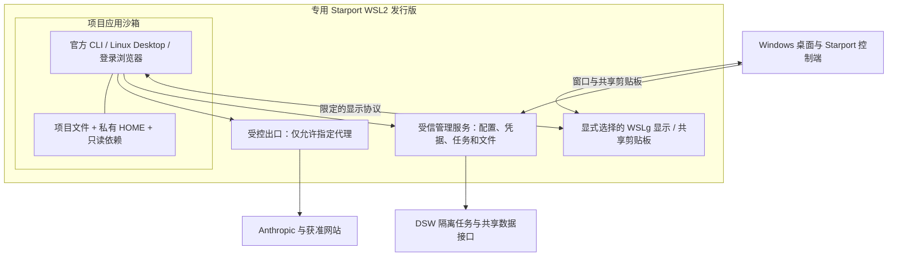

# Windows：WSL2 与 WSLg 可行性评估

更新日期：2026-11-01。控制端、进程管道、项目命名空间、SDK 和显式启用的 WSLg 启动器已实现，见 [Windows 控制端](WINDOWS-HOST.md)。Windows 实机已验证导入、发行版重启、网络／文件边界与真实 SDK Write／Read。账号授权、Desktop 工具调用与整机冷启动恢复仍须分别验收；下文的设计建议不等于全部已通过。

## 结论

Windows 当前采用 **专用 WSL2 发行版＋可选 WSLg＋项目应用沙箱**。WSLg 负责原生窗口体验，应用沙箱负责限制文件、环境和网络。这一组合不要求用户再手动管理一个 QEMU 桌面，但不能把 WSL2 本身当作安全沙箱。

微软明确说明，WSL 发行版提供功能性的进程和文件系统分离，但不是 Windows 宿主或同一用户其他发行版之间的安全边界。拥有发行版 root 权限的代码可以改变其配置。因此模型、工具和项目脚本不能作为管理用户在普通 WSL Shell 里运行。[WSL 安全模型](https://github.com/microsoft/WSL/blob/master/doc/docs/technical-documentation/security.md)

WSLg 已支持开始菜单、任务栏、Alt＋Tab 和跨系统剪贴板；同一 Windows 用户的发行版共用 WSL 虚拟机与 Linux 内核，每个发行版有自己的 WSLg system distro。无需重新开发整个窗口系统。[微软 GUI 指南](https://learn.microsoft.com/en-us/windows/wsl/tutorials/gui-apps)、[WSLg 架构](https://github.com/microsoft/wslg)

## 能力与待验证项

| 需求 | 依据与实施判断 | 状态 |
| --- | --- | --- |
| 官方 Claude Code CLI | Linux/WSL 支持现成；原生账号登录保留在工作区 | 2.1.309 已安装，账号授权与真实调用待用户登录 |
| 官方 Desktop | Linux beta 支持 Ubuntu/Debian；通过 WSLg 显示具有可行基础 | 官方 WSL 推荐组合是 Windows Desktop＋WSL；Linux Desktop＋WSLg 需专项验证 |
| 浏览器登录 | Chrome/Firefox 安装到项目运行环境，明确指定内部 opener | 须核对 CLI、Desktop 深链与回调，不允许落回 Windows 浏览器 |
| 原生窗口 | WSLg 将 Linux 应用窗口投射到 Windows | 已显示 Desktop 欢迎页和 Chrome 官方登录页；账号任务待测 |
| 剪贴板 | 显式启用 WSLg 后共享 Windows 剪贴板 | 不提供显示或剪贴板隔离；可能暴露身份和文档内容 |
| Windows 文件保护 | 独立 rootfs、项目白名单、关闭 DrvFs 自动挂载与程序互操作 | 普通和 GUI 项目边界负例已实测 |
| 受控联网 | 工作区独立网络命名空间，唯一代理连接；关闭出口后没有直连后备 | 普通和 GUI 策略的 IPv4/IPv6/DNS/元数据/vsock 负例通过，浏览器暂停出口后失败 |
| 现有 DSW 与只读依赖 | 控制端接既有任务/文件接口；管理连接和凭据在沙箱外 | 可复用服务协议，WSL 客户端接入待实现 |
| 手机访问 | 控制面板通过 Access＋Tunnel，模型侧不接收访问者身份头 | 独立控制面能力，不依赖 WSLg；新仓库尚未部署此入口 |

官方 Linux Desktop 的 Code 功能包括会话、差异查看、终端、编辑器和预览。Cowork 另需 QEMU/KVM；不能把 Code 启动成功当成 Cowork 也能运行。[Linux Desktop 要求](https://code.claude.com/docs/en/desktop-linux)

## 建议结构

这是目标拓扑；本机项目链路已实现，DSW 和远程入口仍需按部署独立验收。

## 隔离措施

1. **整段应用进入沙箱。** CLI、Desktop、登录浏览器、Shell、插件及子进程使用同一受限身份。初版优先评估 Linux namespaces/bubblewrap 的 GUI 兼容性；加强档另评估 gVisor systrap。gVisor 适合虚拟机内运行，不要求再启用 KVM，但这不能证明它已兼容 Desktop、浏览器和 WSLg。[bubblewrap](https://github.com/containers/bubblewrap)、[gVisor 平台说明](https://gvisor.dev/docs/architecture_guide/platforms/)
2. **文件只按用途开放。** 单独的项目目录、私有 HOME 与暂存；只读挂载已选择的依赖。不要暴露 Windows 用户目录、其他发行版、整个 /mnt/wslg、宿主 /proc、SSH agent、云配置或管理 socket。Git 全局配置、凭据和宿主 hooks 不继承；导入仓库的内容与历史仍须按实际需要处理。
3. **网络限制来自执行边界。** 工作区网络命名空间没有通向 Windows、局域网或公网的普通路由；只暴露受控代理接口。设置 HTTP_PROXY 只是让软件使用该接口，不能替代阻断规则。代理失败后保持关闭。
4. **环境按允许列表创建。** 使用通用用户/主机名、私有 HOME、UTF-8 与指定时区。移除 Windows PATH、WSL_INTEROP、SSH/云环境变量；不复用生成的 DNS 搜索域和宿主 hosts 文件。WSL/Microsoft 内核或通用硬件信息可能仍可见，不承诺隐藏虚拟化特征。
5. **只开放必要 GUI 通道。** 优先 Wayland；不要把整个用户 D-Bus、PulseAudio、X11 和 WSLg 目录一并挂入。若 Desktop 需要 X11，单独评估嵌套 X server/显示中继。显示、剪贴板、文件选择都需要按实际通道验收。[Flatpak 权限与门户](https://docs.flatpak.org/en/latest/sandbox-permissions.html)
6. **控制凭据不进入项目。** 云凭据、订阅、SSH 管理密钥和 Cloudflare Token 保存在管理侧。项目只获得受限任务/文件接口。官方账号令牌会保存在客户端自己的环境里，不能承诺模型工具永远读不到该客户端的令牌。

## 剪贴板的具体边界

默认 WSLg 剪贴板集成不等于“仅在点击 Starport 按钮时才提供内容”。若需要保持当前手动传递语义，要增加受限的显示/剪贴板中继，并验证应用无法主动拉取 Windows 剪贴板。上游还记录了嵌套 compositor 缺少 clipboard data-control 通知的限制，因此不能提前承诺无感、即时、双向自动同步与完全受控三者都已实现。[上游问题记录](https://github.com/microsoft/wslg/issues/1512)

当前 WSLg 实现选择明确告知后的共享模式，不声称只在点击 Starport 按钮时传递。默认关闭 WSLg；用户要求共享独立窗口时才开启。需要手动文字边界时使用 QEMU 画面方案。不修改全局 WSLg 配置来影响其他发行版。

## 不影响其他 WSL 环境

- 使用独立名称的发行版和安装收据；不会覆盖已有 Ubuntu、Docker Desktop 或项目。
- `wsl.conf` 是单发行版配置；`.wslconfig` 是同一 Windows 用户的全局配置。不得直接覆盖全局文件来实现单项目设置。[WSL 配置作用域](https://learn.microsoft.com/en-us/windows/wsl/wsl-config)
- Hyper-V Firewall 规则按 VMCreatorId 应用，WSL 使用统一的 creator ID。全局拒绝可能影响其他 WSL 工作；初版先把工作区出口限制放在自己的命名空间内，宿主侧加固需要单独核对影响范围。[Hyper-V Firewall](https://learn.microsoft.com/en-us/windows/security/operating-system-security/network-security/windows-firewall/hyper-v-firewall)
- DNS tunneling、autoProxy、mirrored networking 都是便利功能，不能直接当成断线保护。尤其 autoProxy 只配置代理使用方式，不能阻止软件另建连接。[WSL 网络](https://learn.microsoft.com/en-us/windows/wsl/networking)
- 不自动执行影响全部发行版的 `wsl --shutdown`。需要重启本工具时，只处理它自己的发行版，并先确认没有运行会话。

## 验证顺序

1. Windows 11 实机检查 WSL2、WSLg、内核、systemd、命名空间与 cgroup 支持。
2. 创建专用发行版和合成项目，验证 Windows 文件、互操作、宿主服务与直连不可达。
3. 先跑官方 CLI 和浏览器，验证登录只在内部打开、代理关闭时失败、恢复后重连。
4. 再跑 Linux Desktop：独立窗口、输入法、剪贴板、文件选择、终端、工具调用和回调；不以安装成功代替验收。
5. 保持一个长任务，分别关闭窗口、断开代理、重启控制面，确认任务与会话状态不会错误丢失或重复执行。
6. 最后接现有 DSW、只读依赖和远程入口，保持节点资源及网络边界。

若 Linux Desktop＋WSLg 或应用沙箱不能通过验收，保留已经验证的独立虚拟机路线；不自动退回无限制的 Windows Desktop 或普通 WSL Shell。
